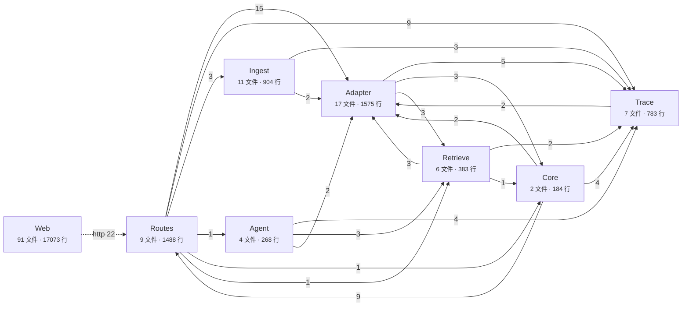

# 仓库代码图概览

> 生成时间：2026-10-24T08:35:49.918Z · 代码版本：`001cac5-dirty` · 范围：`app/server/src` + `app/web/src` · 排除 `*.test.*`、`test-setup.ts`、`legacy.fixtures.ts`、`*.d.ts`。

交互版：打开 `index.html`（单张代码图 + 语义缩放：缩放依次露出模块 / 文件 / 符号 / 方法；左栏点模块摊开全部文件与直接依赖，点文件摊开全部符号与直接依赖。文档图 Wiki 为独立入口）。重跑：`node _Agents/dependency-graph/analyze.mjs`。

## 数字

| 指标 | 值 |
| --- | --- |
| 源文件 | 147 |
| 代码行 | 22658 |
| 物理目录节点 | 71 |
| 模块 | 8 |
| 文件 import 边 | 510（运行时 458 / 仅类型 52） |
| 模块聚合边 | 22 |
| 符号节点 | 945（class 32 · interface 164 · type 58 · function 582 · method 80 · route 29 · enum 0） |
| 符号边 | 1757（call 664 · render 374 · new 26 · ref 545 · extends 7 · implements 10 · route_handler 29 · http 22） |
| 跨文件符号边 | 897 |
| HTTP 契约 | 22 / 22 已匹配，0 unresolved |
| 外部包 | 44 |
| 文件级循环依赖 | 运行时 1 组 · 含类型边 1 组 |

## 模块依赖

实线数字是模块间文件 import 语句数；虚线是解析成功的 HTTP 契约调用数（当前 `web -> routes`）；模块定义在 `module-map.json`。

| 模块 | 层 | 文件 | 行数 | 入口文件 |
| --- | --- | --- | --- | --- |
| Web | presentation | 91 | 17073 | `web/api/client.ts` (57) `web/components/widget/catalog.ts` (27) `web/api/sessions.ts` (26) |
| Routes | interface | 9 | 1488 | `server/routes/health.ts` (4) `server/routes/crud.ts` (3) `server/routes/doc.ts` (1) |
| Agent | application | 4 | 268 | `server/agent/tool/contracts.ts` (3) `server/agent/chat/chat.ts` (1) `server/agent/tool/tools/retrieve.ts` (1) |
| Retrieve | application | 6 | 383 | `server/retrieve/contracts.ts` (10) `server/retrieve/retrievers.ts` (2) `server/retrieve/recipes.ts` (2) |
| Ingest | application | 11 | 904 | `server/ingest/contracts.ts` (13) `server/ingest/chunk/config.ts` (4) `server/ingest/chunk/legacy.ts` (3) |
| Adapter | infrastructure | 17 | 1575 | `server/adapter/contract.ts` (28) `server/adapter/repo/trace.ts` (15) `server/adapter/repo/resource.ts` (10) |
| Trace | infrastructure | 7 | 783 | `server/trace/llmtrace/read.ts` (5) `server/trace/systemtrace/stage.ts` (5) `server/trace/systemtrace/log.ts` (5) |
| Core | infrastructure | 2 | 184 | `server/config.ts` (3) |

## 文件 Hub（出入度最高）

| 文件 | 出度 | 入度 | 行数 |
| --- | --- | --- | --- |
| `app/server/src/adapter/contract.ts` | 21 | 23 | 308 |
| `app/web/src/routes/components.tsx` | 33 | 1 | 738 |
| `app/web/src/components/icon/icon.tsx` | 0 | 32 | 213 |
| `app/web/src/api/client.ts` | 0 | 30 | 717 |
| `app/web/src/components/button/button.tsx` | 0 | 22 | 133 |
| `app/server/src/trace/systemtrace/log.ts` | 0 | 20 | 50 |
| `app/web/src/components/base/base-component.tsx` | 15 | 2 | 287 |
| `app/web/src/routes/ask.tsx` | 16 | 1 | 650 |
| `app/web/src/routes/studio.tsx` | 16 | 1 | 569 |
| `app/web/src/components/card/card.tsx` | 0 | 16 | 49 |
| `app/web/src/routes/ingest.tsx` | 15 | 1 | 130 |
| `app/web/src/routes/resources.tsx` | 15 | 1 | 406 |
| `app/web/src/routes/traces.tsx` | 15 | 1 | 738 |
| `app/web/src/components/run-observability/run-observability.tsx` | 13 | 2 | 468 |
| `app/web/src/components/sidebar/sidebar.tsx` | 14 | 1 | 410 |

## 文件级循环依赖

只统计运行时 import 的环。类型 import 形成的环单列在后面：TS 允许它，且 `type` 导入编译后会被抹掉。

| # | 环 |
| --- | --- |
| 1 | `server/adapter/contract.ts` ↔ `server/adapter/model/registry.ts` ↔ `server/adapter/provider/registry.ts` |

## 外部包（按引用文件数）

| 包 | 引用文件 | 引用次数 |
| --- | --- | --- |
| `react` | 56 | 73 |
| `motion` | 19 | 19 |
| `@tanstack/react-router` | 18 | 20 |
| `tsyringe` | 15 | 15 |
| `reflect-metadata` | 14 | 14 |
| `ai` | 11 | 12 |
| `pg` | 11 | 11 |
| `hono` | 9 | 11 |
| `drizzle-orm` | 4 | 6 |
| `@ai-sdk/provider` | 4 | 4 |
| `react-dom` | 3 | 3 |
| `@ai-sdk/deepseek` | 2 | 2 |
| `@ai-sdk/alibaba` | 2 | 2 |
| `node:crypto` | 2 | 2 |
| `zod` | 2 | 2 |
| `@hono/zod-openapi` | 2 | 2 |
| `@ai-sdk/react` | 2 | 2 |
| `hono-crud` | 1 | 2 |
| `@opentelemetry/api` | 1 | 2 |
| `@opentelemetry/sdk-trace` | 1 | 2 |

## 读图口径

- 单图语义缩放：scale < 0.9 只显示模块；0.9–1.35 展开视口中心最近模块的文件；1.35–2.15 展开最近文件的符号；>2.15 展开最近类的方法。显式点击模块/文件不受阈值限制。
- 布局：模块初始位置由 import/http 聚合边力导；新节点围绕父节点并偏向依赖锚点放置，已有节点位置冻结，展开不整体重排。
- 模块节点来自 `module-map.json`，是图上的点而不是容器框；模块边由文件 import 聚合，`count` 是 import 语句数；`kind: http` 的模块边由前后端 HTTP 契约聚合。
- 文件节点来自真实 AST；物理目录保留在数据里但当前单图不渲染，`contains` 边直接表达 module → file 归属。
- 符号节点 = 顶层函数、类、interface、type、enum、route，以及类方法（`file#Class.method`，`class_id` 指回类）；interface 与 type 分开，type 带 `type_shape`。
- 符号边：`call` 调用、`new` 实例化、`render` JSX 渲染、`ref` 值/类型引用、`extends` 继承、`implements` 实现、`route_handler` 路由绑定、`http` 前后端契约。
- 路由：扫描 `app/server/src/routes/*.ts` 的 Hono 注册与 `crud.ts` 的 hono-crud 端点表，挂载前缀取自 `index.ts` 的 `app.route(...)`。
- `http` 边按 method + path 匹配（前端去掉 `/api`，动态段当通配）；匹配不到的调用留在 `symbol-graph.json` 的 `httpCalls` 里标 `unresolved`，不伪造边。
- `db` / `external` 边与 `table` 节点按 spec 后置，`pending` 标记在 JSON 里；external 只建了 Ollama/DeepSeek/Langfuse/ParadeDB/PostgreSQL/Redis 六个节点。
