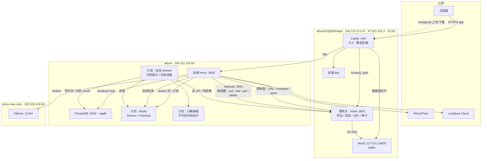

# 部署拓扑（目标态）· 2026-10-29

> 状态：**规划，未落码**。当前代码仍在 `macbookneo` 上以 dev 模式运行（前端 :5173、后端 :3000）。
> 本文只固定目标部署形状、端口与已实测约束；迁移动作单独开 story。
> 与 `implementation-artifacts/handoff-*.md` 的分工：handoff 按会话，本文按部署形状长期维护。

## 一、机器

| 节点 | Tailscale | 公网 | 规格 / 形态 | 目标职责 |
|---|---|---|---|---|
| `macbookneo` | 100.72.5.119 | — | macOS，开发机 | 开发期前端 + 后端；迁移后只保留开发环境 |
| `aliyun` | 100.111.110.60 | 未记录 | linux | 后端 Hono + ParadeDB；计划加 Redis 与常驻运行时 |
| `aliyun2c2g300mbps` | 100.113.172.47 | 47.101.151.2 | **轻量应用服务器**，2C2G，华东2（上海） | 前端静态、Caddy、薄网关、MinIO |
| `lynxs-mac-mini` | 100.103.104.50 | — | macOS | Ollama（qwenembed，1024 维） |
| SaaS | — | — | — | SiliconFlow（chat）、Langfuse Cloud（trace） |

## 二、目标拓扑

## 三、三条路径

| 调用方 | 入口 | 鉴权 | 数据面 |
|---|---|---|---|
| 浏览器 | Caddy :443（公网 TLS） | presigned URL 内嵌自签 token + `forward_auth` | Caddy 直翻 `127.0.0.1:9000`，**不过 Node** |
| 后端 | 薄网关 :9001（Tailscale 内网） | 服务间（Tailscale ACL） | Node 用 S3 SDK 流式转发 |
| 持续运行系统 | 薄网关 :9001（本机或 Tailscale） | 服务间 | 同上 |

原则（2026-10-29 拍）：

- **后端不走 Caddy**：内部流量不经过公网入口，不受其限流、证书、DNS 影响
- **MinIO 只听 `127.0.0.1`**：外部入口只有 Caddy 和薄网关
- **凭证只在薄网关**：后端 `ObjectStore` 换成 HTTP 实现，不再持 S3 密钥
- **文件流不过 Node**（浏览器侧）：Caddy 反代，避免 2G 内存被大文件缓冲打爆

## 四、端口与端点

| 位置 | 端口 | 暴露面 | 说明 |
|---|---|---|---|
| 2c2g | 443 | 公网 | Caddy：前端静态 + `/api` 反代 + MinIO 数据面 |
| 2c2g | 9000 | **仅 localhost** | MinIO S3 API |
| 2c2g | 9001 | Tailscale | 薄网关：控制面 + 后端数据面 + `/auth` |
| aliyun | 3000 | Tailscale | 后端 Hono |
| aliyun | 5432 | Tailscale / localhost | ParadeDB |
| aliyun | 6379（计划） | localhost | Redis |
| mac-mini | 11434 | Tailscale | Ollama |

浏览器侧 presign endpoint 与后端侧 S3 endpoint 不是同一个 Host：前者是对外入口（`files` 域名或 `IP:9000`），后者是 `127.0.0.1:9000`。两套签名各自计算，互不干扰。

## 五、已实测（2026-10-29）

| 事项 | 结果 |
|---|---|
| 公网 443（47.101.151.2） | **已通**（TCP 连接成功）；云防火墙规则「TCP 443 / 0.0.0.0/0」已启用 |
| 公网 80 / 9000 | timeout，未放行 |
| 公网 22 | **禁用**；SSH 走 Tailscale `100.113.172.47:22` |
| 2c2g 防火墙形态 | **轻量应用服务器云防火墙**（非 ECS 安全组）+ 本机 ufw |
| 2c2g 443 上的服务 | 曾为 `tailscale serve`（走 ts.net 返回 502），已 `tailscale serve reset` |
| 临时验证服务 | `python3 -m http.server 443` 会把 home 目录暴露到公网，验证完必须停 |
| presigned URL 注入自定义 query token | 签名前注入 **200**；签名后追加或改写 **403** |
| MinIO 分片（2026-10-26） | presigned UploadPart 可用；非末片 5 MiB 下限；`ListMultipartUploads` 恒空，断点续传需自持久化 `uploadId` |
| IP 证书 | Let's Encrypt 已签发 IP 证书，约 6 天，支持 HTTP-01 / TLS-ALPN-01；Caddy 需显式 `profile shortlived`（默认对纯 IP 用内部自签） |

## 六、未决项

| 项 | 当前倾向 | 触发点 |
|---|---|---|
| 域名 vs 纯 IP + IP 证书 | 先用 IP + Let's Encrypt IP 证书跑通 | 需要分享给外部用户 / 证书自动续不稳 |
| 薄网关落点 | 2c2g，与 MinIO 同机；本次先不实现 | 需要「后端不持凭证」或「分片会话」时 |
| 分片上传 | 暂不做；现为单次 presignPut | 出现大文件需求 |
| 分片与上传前去重冲突 | 未拍：前端增量 hash（保秒传） vs 放弃大文件秒传 | 上分片之前 |
| Redis | aliyun 同机；Stream 存流、Pub/Sub 广播 | 后端多实例或断线续接 |
| 常驻运行时 / 沙箱 | aliyun 同机起步；跑不可信代码再拆第三台 | P3 之后；需先定「沙箱跑固定工具还是 LLM 生成代码」 |
| Ollama | 留在 `lynxs-mac-mini` | ingest 延迟不可接受或家里机器不可靠时 |
| 代码索引 Worker（L2） | aliyun 同机起步，容器限资源；跑不动再拆机 | 代码图 / 代码 RAG 开工时 |
| 沙箱运行时（L3） | 独立机器 + 容器隔离 | P3 之后；先定「跑固定工具还是 LLM 生成代码」 |
| 代码解析语言范围 | 先 TS/JS | 出现仓库主语言不是 TS/JS 时 |

## 七、代码库处理（L2）

定位：把 MinIO 里的代码库 ZIP 变成可查询的代码索引，**不执行**任何仓库内容。

| | 内容 |
|---|---|
| 输入 | `codebases` 行的 ZIP，经薄网关读取 |
| 处理 | 安全解压到临时工作区（zip-slip / 压缩炸弹 / 100MB 实际上限）→ AST 解析（先 TS/JS）→ 符号表与模块依赖边 → 按函数/类切块 |
| 产物 | 写 Postgres 的代码侧表；与文档侧 `chunks` / `embeddings` **分表**（5.4 已拍「代码与知识库分离」）。工作区用完即删，不持久化 |
| 不做 | 执行代码、跑测试、提供 Git 服务、替代 MinIO 网关 |
| 形态 | 常驻 Worker 的一个任务 handler；与沙箱 runner 共用 Redis，但**不同队列、不同容器**（可信解析 vs 不可信执行） |
| 落点 | `aliyun` 同机起步，容器限 CPU / 内存；峰值按「解压后体积」估，跑不动再拆机 |
| 与 agent 的关系 | 产物供 P3 的代码检索工具消费；先建索引，工具后接 |

与现有代码的接缝：`codebase/zip.ts` 的中央目录校验、`archive.ts` 的完成流程可复用；`reader.ts` 的 S3 range 预览保持不变，L2 产物是叠加的索引，不替代按需读。

## 八、与代码的接缝

- `app/server/src/adapter/storage/object-store.ts` 的 `ObjectStore` 接口是唯一替换点：进程内 S3 调用 → HTTP 调薄网关
- `app/server/src/adapter/storage/s3.ts` 的 `createS3Client` 在迁移后移入薄网关
- `app/server/src/resource/archive.ts`、`download.ts`、`codebase/archive.ts` 只依赖接口，不随迁移改动

## 九、迁移顺序（待放行）

1. 后端迁到 `aliyun`，`DATABASE_URL` 改 localhost，前端仍从开发机跑
2. 前端 build 上 2c2g + Caddy + TLS（IP 证书或域名），presign endpoint 换成对外入口
3. 薄网关接管签发与分片控制，后端改调网关、不再持凭证
4. Redis 与常驻运行时按触发点单独开 story
