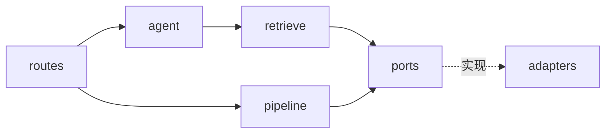

# Architecture Spine — Knowledge Copilot P1

## Design Paradigm

**分层 + 端口/适配器（hexagonal-lite）。** 两条互不依赖的主路径共享同一组端口（接口）：

- **入库管线 pipeline**：fetch → parse → chunk → embed → 写入（走存储端口）。
- **检索层 `retrieve/`**：问句 → 混合检索（向量 + 词法）→ 名次融合 → 命中。
- **问答编排层 `agent/`**：库状态判定 → 调检索 → 组装上下文 → 生成 → 流式下发。

依赖方向恒为**由外到内**：route → agent / retrieve / pipeline → ports → adapters；适配器实现端口，反向不依赖。好处：P3 把检索/联网变"工具"、P5 接 MCP 时只增适配器与编排调用，不动核心。

## Invariants & Rules

### AD-1 — 分层与两条路径 [ADOPTED]

- **Binds:** all（FR-1…FR-12）
- **Prevents:** route 里直接连库/调模型，业务逻辑散落导致 P3/P5 扩展要重写。
- **Rule:** 后端按 `routes / agent / retrieve / pipeline / ports / adapters` 分层；入库管线与问答运行时不得互相依赖，只通过 ports 共享能力。
  （层名 `orchestration` 已废除：2026-10-14 Lynx 定，层名跟着 as-built 的两个目录走，不再用一个抽象词占位。）

### AD-2 — 存储写权唯一 [ADOPTED]

- **Binds:** FR-1..FR-5, FR-7, FR-10
- **Prevents:** 多处直接写库造成 Resource/Chunk 状态、引用归属对不齐。
- **Rule:** 只有存储适配器（ParadeDB）经 Repository 端口读写库；管线写 Resource/Chunk/Embedding，编排写 Session/Message/Citation。任何模块不得绕过 Repository 端口直连数据库。

### AD-3 — 核心实体与分表 [ADOPTED]

- **Binds:** FR-1..FR-5, FR-10, FR-11
- **Prevents:** chunk 与向量混一张表 vs 分表两处各建各的。
- **Rule:** 实体 `resources / chunks / embeddings / sessions / messages`；**chunks 与 embeddings 分表**（照 WeKnora），embeddings 以 `source_id + source_type` 关联 chunk；resource 状态取 `处理中/已就绪/失败`（见 PRD Glossary）。去掉 WeKnora 的 tenant 维度。

### AD-4 — 向量维度与半精度索引 [ADOPTED]

- **Binds:** FR-4, FR-6, FR-10
- **Prevents:** 查询向量与入库向量维度/模型不一致导致检索静默返回垃圾；也把某个具体维度当架构常量、绑死模型选择。
- **Rule:**
  - **存储**：`embeddings.embedding` 存**不定长 `halfvec`**（照 WeKnora 单表混维）——列本身**不设维度上限**，任何维度都能存。
  - **索引**：只为需要检索加速的维度**各建一条 partial HNSW 表达式索引** `USING hnsw ((embedding::halfvec(N)) halfvec_cosine_ops) WHERE dimension = N`，每条 `N ≤ 4000`（pgvector halfvec HNSW 上限）。**当前 P1 只用一个 1024 维模型 → 只有一条 1024 索引**；未来加维度 = 加一条索引，不动表。
  - **查询期一致性**：查询向量的模型与 `dimension` 必须与被检索行相等，不符直接报错、不回退静默作答（参考 WeKnora 维度校验码 2201）。若查询维度**没有对应的 partial 索引**，Postgres 退化为 **seq scan**（结果仍正确，仅性能下降），不作为拒绝理由。
  - **命中索引的表达式形式**：查询必须写 `embedding::halfvec(N) <=> $1::halfvec(N)`（与 partial 索引定义同表达式），否则优化器不走索引。

### AD-5 — 混合检索 [ADOPTED]

- **Binds:** FR-6
- **Prevents:** 只向量或只 BM25，两处对"命中"定义不一致；低相关噪音被当依据。
- **Rule:** 检索 = 向量相似度（HNSW）+ ParadeDB `pg_search` BM25（中文 Lindera 分词）混合。相关性低于下限视同"未找到"，据 PRD FR-6 拒答（阈值属实现层）。

### AD-6 — 流式契约 [ADOPTED]

- **Binds:** FR-6, FR-7, FR-8, FR-9, FR-10, FR-11
- **Prevents:** 前后端各造 SSE 格式、`useChat` 解析对不上；引用与正文时序错乱。
- **Rule:** 沿用 Vercel AI SDK **UI Message Stream** 协议，前端 `useChat` 消费。引用作为独立 **`sources` data part** 先于/随答案下发（照 WeKnora `references` 先行）；正文用 `[n]` 标记，`sources` 携带 `{marker, chunkId, docTitle, url, snippet}`。事件经内存 SSE 直连，**不做持久化重放**。

### AD-7 — Provider 抽象与实选 [ADOPTED]

- **Binds:** FR-4, FR-6, FR-12
- **Prevents:** 模型服务商硬写进业务，换模型/加模型改动核心。
- **Rule:** 经 AI SDK provider 抽象。Embedding = **本地 Ollama 跑 Qwen3-Embedding（原生 1024 维，无外部 Key）**；对话 = **DeepSeek 与 百炼（DashScope）**，均 OpenAI 兼容，配置项切换。Embedder / ChatModel 是端口，各服务商是适配器。

### AD-8 — 本地安全边界 [ADOPTED]

- **Binds:** FR-12
- **Prevents:** 本地自用顺手裸公网，收藏内容与 Key 一起泄露。
- **Rule:** 默认仅 `127.0.0.1` 监听；DeepSeek/百炼 API Key 仅存服务端环境变量、不下发前端；对外演示用只读或临时实例。

## Consistency Conventions

| Concern | Convention |
| --- | --- |
| Naming | 实体/表 snake_case（`resources`,`chunks`,`embeddings`）；TS 类型 PascalCase；端口名词（`Repository`,`Retriever`,`Embedder`,`ChatModel`），适配器 `*Adapter` |
| Data & formats | 所有主键 `id` = UUID；时间 UTC ISO8601；向量 `halfvec`（不定长，按 `dimension` 分建 partial HNSW）；错误统一 `{code,message}` 结构 |
| State & cross-cutting | 状态变更只经 Repository 端口（AD-2）；配置来自环境变量；日志最小可用；无 auth（单人自用） |

## Stack（SEED — 冷启动为真，代码落地后由代码拥有；精确版本 scaffold 时钉）

| Name | 用途 |
| --- | --- |
| Vercel AI SDK（`ai`） | streamText、embed、provider 抽象、UI Message Stream |
| Hono（Node 运行时）+ TypeScript | 后端 HTTP + SSE |
| Vite + React + TypeScript | 前端；`useChat` 消费流 |
| ParadeDB（`paradedb/paradedb` Postgres 镜像，含 pgvector + `pg_search`/BM25 + Lindera） | 存储与检索（本地 Docker 起） |
| Ollama | 本地跑 Qwen3-Embedding（1024 维） |
| DeepSeek / 百炼 DashScope（OpenAI 兼容） | 对话 LLM |

## Structural Seed

```text
app/
  server/                 # Hono + Node
    routes/               # HTTP 入口（ingest / kb / chat SSE）
    agent/                # 问答编排：库状态→调检索→组装→生成→流式
    retrieve/               # 检索层：向量 + 词法 + 融合，可被 agent 或工具调用
    pipeline/             # 入库管线：fetch→parse→chunk→embed→写
    ports/                # 接口：Repository, Retriever, Embedder, ChatModel
    adapters/             # paradedb / ollama / deepseek / dashscope
  web/                    # Vite + React，useChat 消费 SSE
```



## Deferred（本 MVP 决定不做，留接口/后续阶段）

- **会话所有权在客户端，后端只认 `sessionId`**（2026-10-14 Lynx 定）：用户点「新对话」建会话，之后每个请求带 id。UUID 不可猜 = 当下的隔离手段，P1 无 auth（AD-8 仅本地监听）。**业务 SQL 里不写 `user_id = $1` 这类 owner 谓词，也不给 resources/chunks/messages 补 owner 列** —— 隔离的归属只能有一个来源。
- **未来的多用户隔离走 Postgres RLS，不走应用层过滤**（同上决定）。上 RLS 的硬前提记在这里，别到时候踩：`pg-pool` 复用连接，身份必须在**事务内**用 `SET LOCAL app.user_id = …` 下发（`connect → BEGIN → SET LOCAL → query → COMMIT`）；沿用现在的 `pool.query()` 会让上一条请求设的会话级 `GUC` 跟着连接漏给下一个请求。⇒ 那是改数据访问形状的活，属 P3 工程项那一刀，不在 Epic 2 范围内。
- 断线重连 / continue-stream / Redis 事件流（WeKnora 那套，本地自用不需要）。
- 多租户、账号、权限、协作。
- 父/子分块层级、chunk 图关系、重排序（rerank）模型。
- Query rewrite / 指代消解的具体策略（实现层，AD-5 只约束行为）。
- 多模态入库、MCP、工具化检索/Agent（P3/P5，端口已为此留位）。
- 生产部署与运维、字符级高亮回链（PRD §6.2 延后项）。
