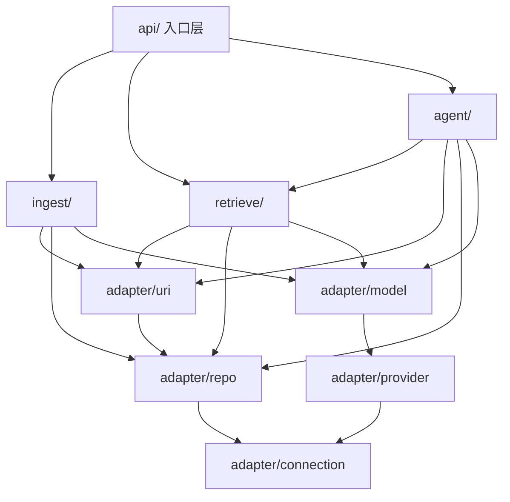

# Architecture Spine — Knowledge Copilot 后端（第二版）

> **as-built 对照（2026-10-24）**：本脊的 `api/` 是入口层的设计名，实际目录是 `app/server/src/routes/`；`ingest/` 实际文件是 `contracts.ts` / `recipes.ts` / `ingest.ts` / `inflight.ts` + `fetch|parse|chunk/`；`retrieve/` 实际是 `contracts.ts` / `recipes.ts` / `retrievers.ts` + `fusion/` / `search/`；另有 `agent/chat/`、`agent/tool/`、`trace/` 与 `adapter/model/embed-chunks.ts`。**Structural Seed 是 2026-10-15 的种植图，不是 as-built**；当前以 `app/server/src/` 为准。

## Design Paradigm

**三层垂直能力片（capability-first）**。纵向按"谁拥有事实"切，不按技术角色横切：

| 层 | 盒 | 职责一句话 |
| --- | --- | --- |
| 入口层 | `api/` | 唯一知道 HTTP 的地方：校验、出参投影、错误→状态码、对外接口契约 |
| 能力层 | `ingest/` `retrieve/` `agent/` | 用例编排：入库全周期 / 只读检索 / 模型作答 |
| 基础层 | `adapter/`＝`uri` · `repo` · `model` · `provider` · `connection` | 唯一的事实所有者：地址、行、模型、服务商、连接 |

根文件（`index.ts` `config.ts`）不属于任何层：装配与启动序列、env 装载与校验（2026-10-20 DI 改造删掉 `bootstrap.ts`：构造交给了容器，根文件只剩"按序 resolve + 启动序列"两件事）。跨层共享实体盒 `types/` 已下线（2026-10-16 Lynx 定）：实体形状随它的行投影住 `adapter/repo/`，别盒要用哪一位由 `adapter/contract.ts` 点名交出（现交 `Resource`）。



依赖方向恒为由外到内。基础层不 import 能力层，`repo` 不 import `uri`。

## Invariants & Rules

### AD-1 — 三层与依赖方向 [ADOPTED]

- **Binds:** all
- **Prevents:** 层间打穿。第一版的实测后果：5 个文件各自持有 SQL、检索目录反向 import 入库的 embedder、路由直接持有连接池。
- **Rule:** 只允许 `api → 能力 → adapter`，以及 `adapter` 内部 `uri → repo`、`model → provider`。能力片之间只准调用对方 `contract.ts` 导出的服务，禁止 import 对方内部文件。同层不互相 import 内部文件。

### AD-2 — 基础层是唯一的事实所有者 [ADOPTED]

- **Binds:** FR-1…FR-6, FR-10, FR-11
- **Prevents:** 同一份事实出现第二个来源；基础层慢慢长出业务判定，变成"什么都放"的抽屉。
- **Rule:** `adapter/` 只装五类东西：**地址**（`uri`）、**行**（`repo`）、**模型句柄、元信息与 embed 调用封装**（`model`）、**服务商接入**（`provider`）、**连接**（`connection`＝外部服务的到达方式：pg 池、Ollama 的原生地址与探活）。它不含业务判定（不判"该不该作答""够不够相关"）、不认 HTTP 语义、不认"提问"与"会话"。要放第六类，先改本条。**P2 预告**：Epic 5 的 ObjectStore 若落 `adapter/`，就是第六类；开工前先改本条，或把它留在能力片（见 `epics.md` `OQ-5.1-1`），不默认。（`connection/` 是 2026-10-15 由 Lynx 增补的第五类；`ollama.ts` 原先寄在 `provider/`，与本条「服务商接入」混过一格——原生 `/api/tags`、`/api/ps` 探针不是 SDK 网关，归连接。）

### AD-3 — 库访问唯一归属 [ADOPTED]

- **Binds:** FR-1…FR-6, FR-11
- **Prevents:** 软删与就绪谓词漏写（检索静默读到已删或未就绪内容）、连接池散落、事务边界漂移。
- **Rule:**
  - `new Pool` 只出现在 `adapter/connection/pool.ts`；SQL 文本只出现在 `adapter/repo/`。池由 `adapter/contract.ts` 在门内造出并塞进 repo 的具名方法，门**不导出 `Pool`**，也不导出任何"借连接"的原语。
  - 所有读 `chunks`/`embeddings` 的查询都必须是 `repo` 的**具名方法**，谓词（未软删）内建在方法里，不由调用方拼。
  - 向量与词法两条候选查询同样住 `repo`；融合、阈值换算、limit 截断属 `retrieve/`。（此案可翻，代价＝两个文件的归属。）
  - 核对：`grep -rn "\.query(" app/server/src` 只应命中 `adapter/repo/` 与 `adapter/connection/pool.ts`（那条 `SELECT 1` 探活）；`grep -rn "new Pool" app/server/src` 只应命中 `adapter/connection/pool.ts`。
  - **已知偏差（2026-10-22，Drizzle + hono-crud）**：`routes/crud.ts` 用 hono-crud 给 `resources`（仅 list/read）、`sessions`、`messages`、`traces` 注册 CRUD；查询由 hono-crud + Drizzle 生成，不经过 `adapter/repo/` 的具名方法。这是本条的具名例外，尚未回写为 AD；新增写端点前先决定是补例外还是收回 `repo`。

### AD-4 — 服务商与模型分格；调用点在能力片 [ADOPTED]

- **Binds:** FR-4, FR-6, FR-8, FR-12
- **Prevents:** "唯一入口"被读成两种很不一样的东西；把 AI SDK 挡在转发层后面，每加一个 SDK 特性都要多一层包装。
- **Rule:**
  - `adapter/provider/` 是全系统**唯一 `createOpenAICompatible()` 的落点**；缺 Key 的服务商不进表。表的值类型注 `ProviderV4`（`@ai-sdk/provider`），不注 `OpenAICompatibleProvider`、更不注任何句柄类型。
  - `adapter/model/` 是**唯一兑换 SDK 模型句柄**的落点（`embeddingModel()` → `EmbeddingModelV4`，`languageModel(id)` → `LanguageModelV4`），并同时交出该模型的元信息（id、种类、维度）。
  - SDK 的**调用位**两格分放（2026-10-16 Lynx 定，推翻原句"`streamText` / `embedMany` 都在能力片调用"）：`embedMany` 的封装住 `adapter/model/embed-chunks.ts`，由 `adapter/contract.ts` 交出，含它自报的截维与 30s 超时、取消 Signal 由调用方并进来；`streamText` 留 `agent/`，prompt 组装、上下文编号、流的形状都跟着留能力片。业务判定（该不该作答、命中够不够）一律不进 `model/`。
  - `provider/` 不选模型，`model/` 不判业务，只交出句柄与调用封装。
  - 措辞固定为"**唯一造客户端的地方**"，不是"唯一用 SDK 的地方"。
  - 核对：`grep -rn "createOpenAICompatible" app/server/src` 只应命中 `adapter/provider/`。

### AD-5 — 全局 uri 是引用、去重、回链、降级的唯一来源 [ADOPTED]

- **Binds:** FR-1, FR-5, FR-10, FR-11
- **Prevents:** 一个概念散在多处各拼一套（第一版实况：生成在管线、复制在仓储、带出在检索 SQL、投影在两条路由、落库在消息 jsonb）；来源删除后引用悬空。
- **Rule:**
  - 资源级地址由 `uri.mintResourceUri()` 生成：URL 来源用其本身，粘贴内容用 `urn:kc:paste:<uuid>`。
  - 入库去重的键只由 `uri.canonicalize()` 定义（query、hash 怎么削，别处不得自行裁）。
  - 引用与回链**只能使用 `uri.composeChunkRef()` 产出的单一字符串**，不得由调用方拿 `chunkId + offset + dataUri` 自行拼装。
  - `uri.resolveRef()` 返回三态 `ok | deleted | unknown`；FR-5/FR-10 的"来源已删除"降级由 `deleted` 态驱动，不由调用方比字符串或猜。
  - `uri` 需要读库时只能经 `repo`。

### AD-6 — 一盒一扇门 [ADOPTED]

- **Binds:** all
- **Prevents:** 内部实现被 import 走；装配层长成杂物袋（第一版实况：`bootstrap.ts` 的 9 字段 `Deps` 同时装 config、池、工厂、登记表与可后填的体检值）。该袋已于 2026-10-20 随 DI 改造整删，但这条防线不作废：它的现行等价形状是 `RetrieverDeps.config` 交出去的是整个 `AppConfig`（12 位，含 `databaseUrl`），字段名以 `config.ts` 为唯一出处、不再叠一层改名子集——将来若发现检索层实际用到的位太少，再收窄回一份窄契约。
- **Rule:** 每个盒子唯一的对外文件是它自己文件夹内的 `contract.ts`；别盒只准从它 import。
  - **基础层是例外：`adapter/` 用单一 `adapter/contract.ts` 门，不逐盒建门**（`repo/`、`provider/`、`connection/` 内不再有 `contract.ts`；后建的 `uri/`、`model/` 也不建）。理由：这四格交出的是同一族「事实服务」，逐盒建门会把「哪件事归哪格」这道选择题推给调用方，而 AD-2 的"唯一事实所有者"只有一道门才名副其实；门内仍按格分文件，归属靠文件名表达。
  - `ports/` 与 `adapters/` 两个目录在本架构中不存在——它们的职责被"每盒自带 contract"与 `adapter/` 这道门吃掉了。
  - **已知偏差（2026-10-20，Story 2.6 as-built）**：`RetrieverHandle` 住在 `adapter/contract.ts`，构造期 import `retrieve/retrievers` 的 `RetrieverFactory` 与 `retrieve/recipes` 的 `RETRIEVER_RECIPE_NAMES`；`agent/tool/retrieve.ts` 与 `routes/retrieve/retrieve.ts` 从实现文件取 `RetrieverError`。这是把 Retriever 收成单例句柄的落地形状；按 Lynx 2026-10-20 决定先记账、不移动代码。若后续依赖图出现环，按 AD-6 把 `RetrieverHandle` / `RetrieverError` 移回 `retrieve/contracts.ts` 或拆窄接口。详见 `deferred-work.md`。

### AD-7 — Resource 状态只有一个写入者 [ADOPTED]

- **Binds:** FR-1…FR-5
- **Prevents:** 多处写状态导致状态机与引用归属对不齐。
- **Rule:** `processing / ready / failed` 与软删只由 `ingest/` 触发（SQL 仍住 `repo`）。重启遗留清扫是 `repo` 的具名方法，由根文件在 `serve()` **之前 await 完成**（当前落点：`config.ts` 的 `cleanUpOnBoot`，`index.ts` 的启动序列 await 它之后才 `serve()`），不在路由里、不在能力片里散着写。这条"先清后听"是约束不是风格：清扫会 `DELETE FROM chunks`（embeddings 随 FK CASCADE），未 await 的窗口里一个刚提交的真任务会被标 `failed(入库中断)` 并丢掉 chunks——2026-10-20 实测过它被折叠成顶层代码时静默丢掉的过程。

### AD-8 — 混合检索的行为不变量 [ADOPTED]

- **Binds:** FR-6
- **Prevents:** 两处对"命中"定义不一致；把数字阈值当语义判据；静默降级。
- **Rule:**
  - 检索 = 向量候选 + 词法候选，按名次融合（RRF）。词法查询**必须**走 `paradedb.match_disjunction`；用户问句**不得**裸交给 `@@@`（那是查询语法解析器，实测 8 条里 3 条抛错、4 条静默 0 命中）。
  - 相似度阈值只用于兜字符噪声。"库里有没有依据"的判定归模型，不归数字（实测：库里已无该主题的问句仍拿到全库最高相似度）。
  - 维度不符必须显式失败，**不得**静默退回单路检索。
  - `retrieve/contract.ts` 交出的命中形状自带 uri 引用串（⇒ `api/` 不需要 import 基础层）。

### AD-9 — 维度是模型属性，不是常量 [ADOPTED]

- **Binds:** FR-4, FR-6
- **Prevents:** 把某个具体维度当架构常量绑死模型选择；混维库里分数不可比却静默作答。
- **Rule:**
  - 本次检索使用的维度是模型元信息：`model/` 建盒后由它随句柄一起交出（现网暂由 `config.embeddingDimensions` 供给）。库里实际存在哪些维度是数据事实 `repo.dimensionsInStore()`。两者不符 ⇒ 显式错误。
  - `embeddings.embedding` 列不设维度上限（不定长 `halfvec`）；只为需要加速的维度各建一条 partial HNSW 表达式索引，未来加维度＝加索引，不动表。
  - 命中索引的表达式形式必须是 `embedding::halfvec(N) <=> $1::halfvec(N)`；`N` 在 SQL 里只能是字面量，因此拼它之前必须 `Number.isInteger` 校验——这是该处唯一的注入防线。
  - `N ≤ 4000` 是 pgvector 的物理上限，不是本地约定；`pg` 的 `<=>` 是**余弦距离**，相似度 = 1 − 距离。
  - env 装载不得对某个具体维度值做偏好性告警。

### AD-10 — 会话所有权在客户端 [ADOPTED]

- **Binds:** FR-7, FR-12
- **Prevents:** 隔离归属出现两个来源。
- **Rule:** 后端只认 `sessionId`，业务 SQL 不写 owner 谓词，不给 `resources`/`chunks`/`messages` 补 owner 列。将来上多用户走 Postgres RLS，硬前提记在此：连接池复用连接 ⇒ 身份必须在事务内 `SET LOCAL` 下发，沿用 `pool.query()` 会让上一个请求的会话变量漏给下一个。

### AD-11 — 本地运行边界 [ADOPTED]

- **Binds:** FR-12
- **Prevents:** 本地自用顺手裸公网，收藏内容与 Key 一起泄露。
- **Rule:** 默认仅 `127.0.0.1` 监听（该值不进取舍、由根 `config.ts` 固定）；服务商 Key 只从服务端环境变量读，不出现在任何出参里；无 auth；对外演示用只读或临时实例。

## Consistency Conventions

| Concern | Convention |
| --- | --- |
| 命名 | 盒目录用名词单数（`uri` `repo` `model` `provider` `connection` `ingest` `retrieve` `agent`）；文件 kebab；每盒唯一 `contract.ts`，基础层除外（`adapter/` 只一道门，AD-6）；导出清单置顶，函数不内联 `export` |
| 词表 | `model` 一词只指 SDK 模型句柄（AI SDK 占词）；领域数据结构称 entity 住 `adapter/repo/`（谁产出行投影谁定义，门点名外交）；服务商称 `provider`。外部 API 的「模型清单条目」不占裸词 `Model`，一律带来源前缀（`OllamaModelEntry` 一族） |
| 出参命名 | 双轨且各有理由：贴库的实体保留 snake_case（`start_offset` 对齐列名），检索命中与引用用 camelCase。**不"顺手统一"** |
| 数据与格式 | 主键 uuid；时间 UTC ISO 8601 字符串（`timestamptz` 由 `repo` 转 `.toISOString()`，`number[] ↔ halfvec` 字符串的转换也归 `repo`，不上抛）；`halfvec` 读回是字符串这一驱动细节不得越过 `repo` |
| 状态与变更 | Resource 状态只经 `ingest/`（AD-7）；行只经 `repo`（AD-3）；地址只经 `uri`（AD-5） |
| 错误 | 领域错误 `{code, message}`；HTTP 映射只在一处 `api/errors.ts`；错误码目录见「对外接口契约」 |
| 配置与日志 | `config.ts` 做 env 装载 + 范围校验，失败当场打印单行结构化 JSON 并 `process.exit(1)`（`AppConfig` 是 `@singleton()` 类，谁先 resolve 都是同一个形状）；**不做模型名选择**——那住 `EmbeddingHandle` / `ChatHandle` 的构造。日志单行结构化 JSON；不打印 Key（长度与哈希也不打）。（已知偏差记在 deferred-work：`I_MODELS` 目前打在 `ModelRegistry` 构造里） |

## Stack（SEED — 精确版本取自 `app/server/package.json`，2026-10-15 实读）

| Name | Version |
| --- | --- |
| Node + TypeScript | `typescript ^7.0.2`、`@types/node ^26.6.5` |
| Hono / `@hono/node-server` | `^4.13.13` / `^2.1.4` |
| Vercel AI SDK（`ai`） | `^7.0.139` |
| `@ai-sdk/openai-compatible` | `^3.0.68` |
| `pg` | `^8.23.1` |
| ParadeDB（Docker，pgvector + `pg_search`/BM25 + Lindera） | `paradedb/paradedb` |
| Ollama（本地 embedding 与临时对话上游） | 远端主机 `:11434` |
| 抓取解析栈 | `jsdom ^30`、`@mozilla/readability ^0.6`、`turndown ^7.2.4` |
| 测试 | `vitest ^5.0.3` + `@vitest/ui ^5.0.3` |

注：`package.json` 是 `type: commonjs` 而 `ai@7` 为 ESM-only，靠 Node 的 `require(esm)` 实测可加载；`tsx ^4.23.15` 负责运行与热重载。

## Structural Seed

```text
app/server/src/
├─ index.ts  config.ts                      # 装配 + 启动序列 · env 装载与校验（bootstrap.ts 已随 DI 改造删除）
├─ api/          contract.ts  app.ts  errors.ts  present.ts  endpoints/
├─ ingest/       contract.ts  recipe.ts  task.ts  status.ts  stages/
├─ retrieve/     contract.ts  guard.ts  fuse.ts
├─ agent/        contract.ts  kbstate.ts  context.ts  stream.ts  session.ts
└─ adapter/      contract.ts                     # 整层唯一的一扇门（AD-6 的基础层例外：不逐盒建）
   ├─ uri/       scheme.ts  reference.ts
   ├─ repo/      write-resource.ts  write-content.ts
   │             read-content.ts  search-vector.ts  search-lexical.ts
   ├─ connection/ pool.ts  ollama.ts
   ├─ model/     registry.ts
   └─ provider/  registry.ts
```

## 对外接口契约

> 本脊不设计前端，但必须把后端承诺的形状钉死——否则消费方会自行拼装，第一版的引用映射就是这么错开的。以下字段由 `retrieve/contract.ts` 与 `adapter/` 那道门里的 uri 服务（`adapter/uri/`，随 AD-5 那一刀建）产出，`api/present.ts` 只做一处投影。

| 端点 | 请求 | 成功出参 | 备注 |
| --- | --- | --- | --- |
| `POST /retrieve` | `{ query, limit? }` | `{ hits: Hit[], vectorCount, lexicalCount }` | 只回原始融合结果，供单独验检索 |
| `POST /chat` | `{ query, sessionId }`（sessionId 必填） | UI Message Stream（SSE） | 检索在内部执行；命中随 `tool-retrieve` part 下发（2026-10-24 修正，原 `limit?` 已删） |
| `GET /resources` | — | `{ resources: Resource[] }` | 实体 snake_case 原样 |
| `GET /resources/:id/chunks` | `?page=&per_page=&search=` | `{ chunks: Chunk[], pagination }` | 含定位偏移；`per_page` 1-100 |
| `POST /resources` | `{ url? , content?, content_type?, title?, chunker? }` | `{ resource, chunk_count, warning? }` | `url` 与 `content` 恰好给一个；`content_type ∈ markdown / plaintext` |
| `POST /resources/:id/abort` | — | 202 | 取消但不删 |
| `DELETE /resources/:id` | — | `204` 无 body | 处理中则先取消再软删 |
| `GET /health` | — | `{ status, probes[] }` | 只移探针，不拆端点不分级 |

> **2026-10-24 状态**：上表是 P1 的种子契约；as-built 以 `app/server/src/routes/` 与 `/doc` 生成的 OpenAPI 为准。表中未列的端点：`/sessions`（hono-crud 的 list/read/create/update/delete + `GET /sessions/:id/messages`）、`GET /resources/:id`、`/resources/stats`、`/traces`、`/observability`。`Hit.ref` 尚未落地（`/retrieve` 现在回 `chunkId + startOffset/endOffset + dataUri`），AD-5 的 `uri/` 盒仍是目标形状。

`Hit` 的固定形状（camelCase，自带引用串，消费方不需二次拼装）：

```ts
interface Hit {
  ref: string            // uri.composeChunkRef() 的产物，引用与回链的唯一句柄
  chunkId: string
  resourceId: string
  chunkIndex: number
  range: [number, number] | null
  docTitle: string
  source: string | null
  content: string        // 原量给（要喂模型），截断归消费方
  score: number          // RRF 名次分，不是相似度
  similarity: number | null
  lexicalScore: number | null
}
```

错误码目录（HTTP 映射只住在 `api/errors.ts`）：

| 码 | 语义 |
| --- | --- |
| `E_BAD_BODY` `E_EMPTY_QUERY` | 请求本身不成立 |
| `E_DIMENSION_MISMATCH` | 数据与模型不符。库中维度是**每请求现查** `dimensionsInStore` 判出的（不再启动缓存）；`E_DIMENSION_UNKNOWN` 已随那条缓存一起删除——库不可达现在冒成 500，不再回 409 |
| `E_CONFIG_MISSING` `E_CONFIG_INVALID` | 启动期 env 缺失或非法（进程退出，不出 HTTP） |
| `E_RESOURCE_GONE` `E_CANCELLED` `E_TIMEOUT` | 入库与资源面 |
| `E_UPSTREAM` | 模型上游故障（区别于业务失败；现状只落 500 + 日志，值得单列待实测） |

## Capability → Architecture Map

| Capability | Lives in | Governed by |
| --- | --- | --- |
| FR-1…FR-4 入库（抓/析/块/嵌/写） | `ingest/stages/` + `adapter/repo` + `adapter/model` | AD-3, AD-4, AD-7, AD-9 |
| FR-5 查看与删除 | `ingest/`（状态唯一写入者） + `api/endpoints/resources.ts` | AD-3, AD-7 |
| FR-6 检索问答（检索半） | `retrieve/` | AD-8, AD-9, AD-3（候选查询在 repo） |
| FR-6 生成半、FR-8 流式、FR-9 后端侧、FR-10 引用 | `agent/` | AD-4, AD-5, AD-8 |
| FR-7 会话内多轮 | `agent/session.ts` + `adapter/repo` | AD-10, AD-3 |
| FR-11 原文回链 | `adapter/uri/` | AD-5 |
| FR-12 本地安全边界 | 根 `config.ts` + `api/` + `adapter/provider/` | AD-11, AD-4 |
| 对外接口契约 | `api/` | AD-6, AD-8 |

## Deferred

- **三格"库无内容"的对外表达** — **2026-10-14 已拍**：一律 200 答案体；检索 0 命中由模型按 instructions 说"未找到"，阈值只兜字符噪声。空库 / 全无 ready 的**后端分流仍未实现**（`resourceCounts()` 无用点），缺口见 `deferred-work.md`。
- **批量入库 + 后台队列 + 跨进程取消**（P3 工程项，Redis 只在这一刀进）。`ingest/contract.ts` 交付 `batch` 位，取消信号目前是 `ingest/task.ts` 的进程内登记处。
- **多格式解析（PDF 等）、多模态入库**（P5）。已确认 `provider` 的同一网关上挂着 `imageModel()` ⇒ 届时是 `model/registry.ts` 多登记一类句柄，结构不动。
- **工具化检索** — **2026-10-21 已交付**（Story 2.6，`tool-retrieve`，`stopWhen: stepCountIs(5)`）。**Agent loop 的其余能力仍归 P3**（联网工具、多工具编排、skill/persona/mcp）；`retrieve/contract.ts` 的形态不再需要改。
- **rerank、父/子分块层级、query rewrite 的具体策略**；**断线重连 / continue-stream**；**生产部署与字符级高亮回链**。
- **多行 INSERT 的分批**：`repo/write-content.ts` 留位不实现。Postgres 单语句 65535 参数上限按分表算：chunks 每条 6 参 ⇒ ≈10,922、embeddings 每条 5 参 ⇒ ≈13,107（原"5900"是把 6+5 当一条算的旧数，推导见 `deferred-work.md`）。等第一篇真长文档再解，仍无样本。
- **`pool` 的 `max` / `query_timeout` / 连接与查询超时进 config**（**归 Lynx 的 AI SDK 那一刀**，基础层迁移不动它）：旋钮今天仍逐字写死在 `adapter/connection/pool.ts`（迁移前在 `adapters/paradedb.ts:12-16`），改为读 config 时一并做，具体数值不提前标定。
- **embed 从自写 fetch 换成 SDK 句柄** — **已完成**（2026-10-16/20）：`adapter/model/embed-chunks.ts` + `embedMany`，`qwenembed.ts` 已退役；MRL 截维走 `/v1` 的实测结论见 `LEARNING.md` 与 `deferred-work.md`。
- **基础层先行期间的双轨禁令**：落地同一条 story 内拔掉旧路径（`adapters/`、`bootstrap.ts` 裸 SQL、`ports/`），旧调用方当刀改接线，不留新旧并存。 — **已执行 @2026-10-15 基础层迁移**：三个目录级旧路径当刀删净，`grep -rn "ports/\|adapters/" app/server/src` 零命中。规则本身对后续每一刀继续有效。
